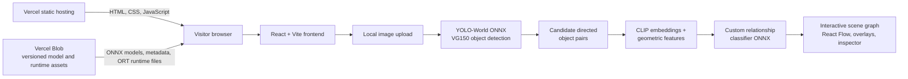

# Scene Graph Explorer

> **From Images to Interactive Scene Graphs, Entirely in Your Browser**

[Live demo](https://scene-graph.vercel.app/) · [Architecture & reproducibility](docs/ARCHITECTURE_AND_REPRODUCIBILITY.md) · [Development journey](docs/DEVELOPMENT_JOURNEY.md)

Scene Graph Explorer turns an uploaded image into an interactive, directed scene graph. It detects objects, predicts semantic relationships between object pairs, and presents the result through image overlays, a React Flow graph, and an inspector. The deployed inference pipeline runs in the visitor's browser: uploaded image bytes are not sent to the historical FastAPI inference service.

## Demo / screenshots

**Screenshot placeholder:** add a small, curated screenshot here after capturing the deployed explorer with an input image, detection overlays, the graph, and the inspector visible. No suitable product screenshot is currently retained in the repository, so this README intentionally does not reference an unverified image path.

Try the application at the [live demo](https://scene-graph.vercel.app/).

## Features

- **YOLO-World detection** configured for the Visual Genome **VG150** object vocabulary.
- **Directed relationship prediction** using candidate object pairs, CLIP visual features, geometric features, and a custom relationship classifier.
- **Interactive scene-graph exploration** with React Flow, image overlays, graph layout, visibility controls, and object search.
- **Shared selection state**: selecting an object or relationship synchronizes the image, graph, and inspector.
- **Object and relationship inspector** for labels, bounding boxes, predicates, and confidence values.
- **Browser-only ONNX inference** with no dedicated Python inference server in the production path.
- **WebGPU-preferred CLIP execution** with a WebAssembly fallback; YOLO-World and the relationship MLP run through ONNX Runtime Web's WASM path.
- **Local image processing** using browser APIs and a worker for image decoding, preprocessing, postprocessing, crops, and scene assembly.

## High-level architecture



Vercel hosts the static frontend, while Vercel Blob delivers public, versioned model and ONNX Runtime assets. **Vercel Blob does not run inference**: model execution and image analysis occur on the visitor's hardware in the browser.

## Technology stack

| Responsibility | Technologies used |
| --- | --- |
| Frontend | React, Vite, React Flow (`@xyflow/react`), Dagre |
| ML training and reference pipeline | PyTorch, YOLO-World, OpenCLIP, custom relationship MLP |
| Browser inference | ONNX, ONNX Runtime Web, WebGPU, WebAssembly, Web Workers / OffscreenCanvas |
| Hosting and asset delivery | Vercel, Vercel Blob |

## How browser inference works

The original models were developed in the Python/PyTorch reference pipeline and exported to ONNX for browser execution. At runtime, the frontend:

1. Resolves the versioned model-asset base URL and downloads the YOLO-World, OpenCLIP visual encoder, relationship MLP, vocabulary, mappings, and ONNX Runtime files from Blob storage.
2. Initializes ONNX Runtime Web sessions. CLIP attempts WebGPU first and falls back to WASM when WebGPU is unavailable or session initialization fails.
3. Decodes and preprocesses the selected local image in a browser worker, runs detection, generates directed object pairs, derives visual and geometric relationship inputs, and builds the public scene-graph JSON.
4. Reuses successfully initialized metadata and model sessions for subsequent analyses during the lifetime of the loaded page.

Asset requests use browser HTTP caching, so later visits or reloads may avoid some downloads when the browser retains valid cached responses. This is distinct from permanent RAM residency: page reloads create a new JavaScript context, and runtime memory remains subject to browser and device pressure.

The production frontend does not require a Python inference service. The retained FastAPI, Python, Docker, and OCI materials are historical/reference artifacts rather than the deployed inference path.

## Running locally

### Scope and prerequisites

This is the current **frontend-only** development workflow. The repository does not declare a single root Node.js version, so use a Node.js version compatible with the installed Vite 6 toolchain. `frontend/package-lock.json` is present, so `npm ci` is the reproducible installation command.

The local Vite configuration depends on the browser-feasibility asset tree at:

```text
experiments/browser-feasibility/browser-yolo-test/public/
```

That directory supplies the large ONNX models, metadata, and ONNX Runtime files through a development/preview-only route. A clean clone without those retained experiment assets cannot perform local browser inference with the default configuration.

### Start the frontend

```bash
cd frontend
npm ci
npm run dev
```

Vite is configured to serve the development site at `http://127.0.0.1:5173`. The local bridge maps requests below `/browser-models/scene-graph-v1/` to the retained feasibility assets; it does not copy those models into `frontend/public` or `dist`.

To exercise the built frontend locally, use the same asset bridge through Vite preview:

```bash
cd frontend
npm run build
npm run preview
```

### Production-like asset configuration

For a build that should load model/runtime assets from an external host, set this **public, build-time** variable to a valid versioned HTTPS prefix before building:

```text
VITE_BROWSER_MODEL_BASE_URL=https://wzbcnqif6ddnztyy.public.blob.vercel-storage.com/scene-graph-v1/
```

This value identifies public read-only assets and is not a credential. Never place `BLOB_READ_WRITE_TOKEN`, private keys, API keys, or any other secret in a `VITE_*` variable, because Vite embeds such values in browser JavaScript.

For the deployed Vercel project, the root directory is `frontend`, the build command is `npm run build`, and the output directory is `dist`.

## Project development

The project evolved from Visual Genome data exploration into a reusable Python scene-graph pipeline, a FastAPI-backed React application, and finally a browser-local ONNX deployment:

1. Visual Genome data exploration and scene-graph representation.
2. YOLO-World object detection and relationship-training data preparation.
3. Relationship prediction using visual, label, and geometry features.
4. Python image-level inference and a FastAPI transport layer.
5. React visualization with overlays, graph interactions, and inspection workflows.
6. ONNX export, browser validation, WebGPU/WASM provider work, and immutable Blob asset delivery.
7. Vercel deployment of the static frontend with browser-local inference.

See the [full development journey](docs/DEVELOPMENT_JOURNEY.md) for the experiments, design trade-offs, validation evidence, and accepted limitations.

## Technical documentation

- [**Development Journey**](docs/DEVELOPMENT_JOURNEY.md) — chronological record of the transition from Visual Genome research work to the browser-only explorer, including feasibility experiments and trade-offs.
- [**Architecture and Reproducibility**](docs/ARCHITECTURE_AND_REPRODUCIBILITY.md) — current production topology, model/data contracts, browser execution details, local setup, asset hosting, validation strategy, and security boundaries.

For implementation entry points, start with:

- [`frontend/src/App.jsx`](frontend/src/App.jsx) for application state and workflow composition;
- [`frontend/src/services/browserInference.js`](frontend/src/services/browserInference.js) for asset resolution, session reuse, provider selection, and orchestration;
- [`frontend/src/services/inferenceWorker.js`](frontend/src/services/inferenceWorker.js) for browser image preprocessing, detection postprocessing, pair preparation, and scene construction.

## Limitations

- **Large first run:** the versioned model/runtime asset set is substantial, so initial download and session initialization can take time.
- **Hardware and browser variability:** performance depends on device capability, browser support, cache state, and whether WebGPU is available; WASM is a functional fallback, not equivalent performance.
- **UI responsiveness:** some ONNX Runtime work can still cause temporary multi-second interface stalls on measured hardware.
- **Parity boundary:** browser and Python inference are not claimed to be numerically identical for every image because preprocessing and runtime behavior can differ.
- **Platform coverage:** validation focused on Chrome in the recorded environment; mobile, low-memory devices, and all desktop browsers are not fully verified.

## Engineering focus

Scene Graph Explorer is an end-to-end engineering project focused on translating a computer-vision research pipeline into an inspectable web application: preserving model contracts, moving inference to browser-local ONNX execution, handling large immutable model assets, and connecting structured ML output to a practical interactive interface.