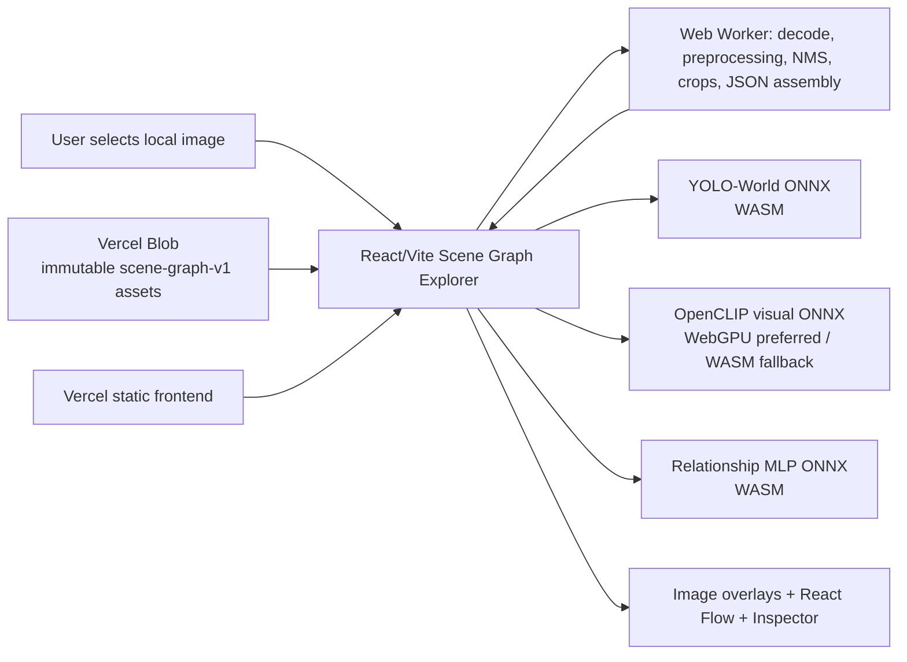
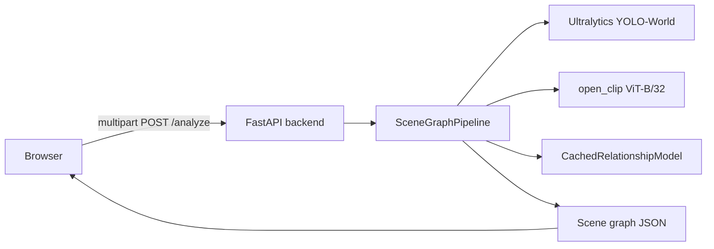

# Scene Graph Explorer: Architecture and Reproducibility

> **Public demo:** [https://scene-graph.vercel.app/](https://scene-graph.vercel.app/)
> **Production architecture:** Vercel-hosted Vite/React UI + immutable Vercel Blob model/runtime assets + browser-local ONNX inference.
> **Important boundary:** the browser downloads code and models from Vercel infrastructure, but image analysis is executed locally in the browser. It does not upload the image to the legacy FastAPI inference service.

## 1. System overview

Scene Graph Explorer accepts a local JPEG, PNG, or WEBP image and produces an interactive directed scene graph:

```text
image → objects with bounding boxes → directed object pairs
      → predicate predictions → scene graph JSON → overlays, graph, inspector
```

The deployed client combines three ONNX models:

1. **YOLO-World VG150 detector** for object detections;
2. **OpenCLIP ViT-B/32 visual tower** for union-crop visual features; and
3. **relationship MLP** for 51-way predicate/no-relationship classification.

The output remains intentionally small and application-facing:

```json
{
  "image": { "width": 800, "height": 600 },
  "objects": [
    {
      "id": "obj_0",
      "label": "person",
      "confidence": 0.81,
      "bbox": { "cx": 100.0, "cy": 200.0, "width": 80.0, "height": 300.0 }
    }
  ],
  "relationships": [
    {
      "id": "rel_0",
      "subject_id": "obj_0",
      "predicate": "riding",
      "object_id": "obj_1",
      "confidence": 0.74
    }
  ]
}
```

It does not expose tensors, logits, embeddings, raw detector outputs, or model internals in its public scene object.



## 2. Historical Python reference versus deployed browser architecture

### 2.1 Python reference architecture

The original application path was server-backed:



`backend/main.py` was deliberately a thin HTTP layer: validate an image, reuse one process-wide `SceneGraphPipeline`, and return `SceneGraphResult.to_dict()`. The actual inference behavior lives in `scene_graph/` and `notebook/models/relationship/`.

This historical path remains useful as source-code and model-provenance material. It is **not** the current public application's inference path.

### 2.2 Current deployed browser architecture

```mermaid
sequenceDiagram
    participant U as User browser
    participant V as Vercel frontend
    participant B as Vercel Blob
    participant W as Inference worker
    participant O as ONNX Runtime Web

    U->>V: Load static React application
    V-->>U: HTML, JavaScript, CSS
    U->>B: Fetch vocabulary, mappings, ONNX models, ORT runtime files
    B-->>U: Versioned immutable assets with CORS/MIME/cache headers
    U->>W: Decode image; build YOLO tensor
    U->>O: YOLO ONNX inference (WASM)
    U->>W: Decode/NMS; make pairs, geometry, unique crops
    U->>O: CLIP ONNX inference (WebGPU or WASM)
    U->>O: Relationship MLP inference (WASM)
    U->>W: Softmax, filtering, deduplication, scene construction
    W-->>U: Public scene JSON
    U-->>U: Render image overlays, graph, and inspector
```

The browser has no inference API request in the production frontend: [`frontend/src/services/api.js`](../frontend/src/services/api.js) re-exports the browser implementation. This is local computation, but not offline installation: the browser still downloads app code and model/runtime assets over HTTPS unless normal HTTP caching can satisfy requests.

## 3. Repository structure and component responsibilities

| Path | Role | Production status |
|---|---|---|
| [`frontend/`](../frontend/) | Vite/React public application | Current production source |
| [`frontend/src/services/browserInference.js`](../frontend/src/services/browserInference.js) | Model URL resolution, session cache, provider selection, orchestration | Current production source |
| [`frontend/src/services/inferenceWorker.js`](../frontend/src/services/inferenceWorker.js) | Image decode/preprocessing, detector decode/NMS, pairs/crops, JSON postprocessing | Current production source |
| [`frontend/src/components/`](../frontend/src/components/) | Image overlays, React Flow graph, inspector, custom edge rendering | Current production source |
| [`experiments/browser-feasibility/scene-graph-v1-asset-manifest.json`](../experiments/browser-feasibility/scene-graph-v1-asset-manifest.json) | Versioned Blob asset contract, hashes, MIME and cache policy | Operational provenance |
| [`experiments/browser-feasibility/upload_vercel_blob.py`](../experiments/browser-feasibility/upload_vercel_blob.py) | Hash-checked immutable Blob publisher | Operational tooling |
| [`scene_graph/`](../scene_graph/) | Python reference pipeline, mappings, detector, feature helpers, postprocessing | Historical/reproducibility reference |
| [`backend/`](../backend/) | Historical FastAPI transport layer | Historical/reproducibility reference |
| [`notebook/models/relationship/`](../notebook/models/relationship/) | Relationship model and feature source | Training/export provenance |
| Historical Docker/OCI deployment materials | Historical deployment route retained outside this focused browser-production release | Historical; not current public topology |

## 4. Technology stack

| Layer | Technology | Responsibility |
|---|---|---|
| UI | React 18, Vite 6 | Upload flow, state, progress stages, rendering |
| Graph visualization | `@xyflow/react`, Dagre | Directed graph nodes, edges, layout, pan/zoom, selection |
| Graph export | `html-to-image` | Download rendered graph as PNG |
| Browser inference | `onnxruntime-web` 1.24.2 | ONNX session creation and execution providers |
| Background CPU work | Web Worker + `OffscreenCanvas` | Decode, pixel conversion, NMS, crops, scene assembly |
| Detector | Static FP32 YOLO-World VG150 ONNX | 149-class object candidates and boxes |
| Visual encoder | FP16-weight OpenCLIP ViT-B/32 ONNX with FP32 I/O | Raw 512-D union-crop embeddings |
| Relation classifier | FP32 dynamic-batch MLP ONNX | 51 logits per directed pair |
| Static hosting | Vercel | Production Vite frontend |
| Asset hosting | Vercel Blob | Immutable model, metadata, and ONNX Runtime files |

## 5. Vocabulary, mappings, and label safety

The model chain uses multiple identifier systems. Keeping them separate is a correctness requirement.

| Value | Meaning | Conversion |
|---|---|---|
| VG object label ID | 1–150 dictionary ID | `label_name_to_vg_id[label]` |
| MLP embedding ID | 0–149 | `VG object ID - 1` |
| YOLO custom class ID | 0–148 | index into the 149-name vocabulary |
| VG predicate ID | 1–50 | dictionary predicate identifier |
| MLP output class | 0–50 | 0–49 map to VG predicate IDs 1–50; 50 is no relationship |

The detector vocabulary is the Visual Genome label insertion order with only `background` removed. It therefore contains **149** names. The mapping JSON served to the browser includes a label-name-to-VG-ID map and a model-class-to-predicate map.

Two values with the number 50 must not be confused:

- **model class 50** = `no relationship`;
- **VG predicate ID 50**, corresponding to **model class 49** = `worn by`.

The reference mapping logic is in [`scene_graph/mapping.py`](../scene_graph/mapping.py).

## 6. Models, tensor interfaces, and inference semantics

### 6.1 YOLO-World detector

The browser detector is an exported, self-contained, static FP32 graph configured with the Visual Genome vocabulary before export. Its primary asset is:

```text
model/yolov8s-world-vg150-640-static-adaptive-max.onnx
```

| Property | Verified value |
|---|---|
| Input | float32 `[1, 3, 640, 640]` |
| Output | float32 `[1, 153, 8400]` |
| Output layout | 4 decoded `xywh` channels + 149 class-score channels |
| Detection confidence threshold | `0.25` |
| NMS | class-aware, IoU `0.70` |
| Maximum retained detections | `300` |
| Browser provider | WASM |
| Artifact bytes | 54,078,927 |

The model is static, batch-one, and 640×640. It is not a drop-in replacement for the original Python predictor's possible rectangular-letterbox route.

### 6.2 Detection preprocessing and postprocessing

The worker decodes the selected file with `createImageBitmap(..., { imageOrientation: 'from-image' })`, then letterboxes it into 640×640:

1. compute `ratio = min(640 / imageWidth, 640 / imageHeight)`;
2. resize to ties-to-even rounded dimensions;
3. center-pad RGB `(114,114,114)`;
4. convert pixels from RGBA to planar RGB float32 in `[0,1]`;
5. submit `[1,3,640,640]` to the detector.

The output is decoded as pixel-space `xywh` in the 640×640 input frame, converted back to original-image `xyxy`, clamped, confidence-filtered, sorted descending, and class-aware NMS filtered. Final objects use original-image center boxes:

```json
{ "cx": 0, "cy": 0, "width": 0, "height": 0 }
```

### 6.3 Directed candidate-pair generation

For objects in detector order, the system creates a row for each ordered pair `(subject, object)` where:

```text
subject index != object index
subject label != object label
```

Reverse pairs are retained. There is no candidate-pair cap. Consequently pair count can grow approximately quadratically with detections after the same-label exclusion.

### 6.4 Expanded union crops and geometry

Each object box is expanded by 20% in width and height. The union of those expanded boxes supplies two related—but intentionally distinct—representations:

- **pixel crop bounds:** union coordinates are ties-to-even rounded and clamped to the image before extracting a crop;
- **geometry basis:** the unclamped mathematical expanded union is used to normalize boxes.

The geometry tensor is float32 `[N,8]` in this exact order:

```text
[ subject_cx, subject_cy, subject_width, subject_height,
  object_cx,  object_cy,  object_width,  object_height ]
```

Every value is normalized relative to the expanded union box.

### 6.5 Exact-pixel crop deduplication

Many reversed directed pairs share the same union crop. The browser worker groups pairs by their exact rounded/clamped crop bounds (`x1,y1,x2,y2`), prepares one CLIP input tensor per unique bound, runs CLIP for unique rows, then copies each resulting 512-D feature back into every directed pair row belonging to that crop.

This is not a semantic approximation. It retains pair direction in label IDs and geometry while avoiding duplicate pixel preprocessing and visual-encoder execution. In the documented 68-directed-pair fixture, 26 unique crop tensors remained after grouping.

### 6.6 CLIP visual encoder

The deployed visual model is a repaired FP16-weight OpenCLIP visual tower with FP32 input/output:

```text
model/d1-fp16-clip-vit-b-32-openai-visual-fp16-io-fp32.onnx
```

| Property | Verified value |
|---|---|
| Input | `image`: float32 `[N,3,224,224]` |
| Output | `image_features`: float32 `[N,512]` |
| Batch dimension | dynamic |
| Internal initializer storage | FLOAT16 |
| Artifact bytes | 176,081,784 |
| Visual feature normalization after encoder | none |
| Preferred provider | WebGPU |
| Fallback provider | WASM |

The preprocessing implemented in the worker constructs a 224×224 tensor from the crop, performs RGB conversion, applies image resizing/cropping behavior, scales channels to `[0,1]`, and normalizes with:

```text
mean = [0.48145466, 0.4578275, 0.40821073]
std  = [0.26862954, 0.26130258, 0.27577711]
```

The original Python/OpenCLIP source transform used bicubic resize with antialiasing and center crop. The browser implementation preserves the intended model contract but has not demonstrated exact pixel/tensor equivalence to the Python/Pillow/OpenCLIP route on all fixtures. See [Known limitations](#15-known-limitations-and-supported-environments).

### 6.7 Relationship MLP

The deployed relation classifier is:

```text
model/d1-relationship-mlp-full-fusion-fp32-dynamic.onnx
```

| Input/output | Shape and type |
|---|---|
| `visual` | float32 `[N,512]` raw CLIP features |
| `subject_label` | int64 `[N]` = VG object ID minus one |
| `object_label` | int64 `[N]` = VG object ID minus one |
| `geometry` | float32 `[N,8]` |
| `logits` | float32 `[N,51]` |

Its architecture is:

```text
subject embedding: Embedding(150, 64)
object embedding:  Embedding(150, 64)
geometry:          Linear(8, 32) → ReLU
fusion:            512 + 64 + 64 + 32 = 672
classifier:        Linear(672,256) → ReLU → Dropout(0.30, inactive in eval)
                   → Linear(256,51)
```

The browser creates int64 label tensors from `BigInt64Array`, preserving the model's indexed-embedding interface. The MLP currently uses WASM because its measured cost is negligible relative to CLIP and it does not need WebGPU for the chosen design.

### 6.8 Predicate decoding and relationship postprocessing

The worker computes stable softmax over each 51-logit row, takes the argmax, then:

1. removes class 50 (`no relationship`);
2. retains only selected-class confidence **≥ 0.30**;
3. converts class 0–49 using the predicate mapping; and
4. deduplicates first occurrence of exact directed `(subject ID, predicate, object ID)` triples.

Relationship IDs are assigned after filtering/deduplication as `rel_0`, `rel_1`, and so on. Object IDs are `obj_0`, `obj_1`, and so on in final detector order.

## 7. UI architecture and synchronized visualization

### 7.1 Shared scene state

`App.jsx` owns the image preview, current scene, selected object/relationship IDs, search, graph visibility state, and graph lock state. The same scene object drives the image view, React Flow graph, and inspector; these views do not hold independent copies of the graph.

### 7.2 Image overlays

[`SceneImage.jsx`](../frontend/src/components/SceneImage.jsx) renders boxes as percentages of the original scene width/height, so they remain aligned as the displayed image scales. Visual priority is selected object, relationship endpoints, search results, then normal boxes. Turning off general detections does not suppress a selected object or selected relationship's endpoints.

### 7.3 React Flow graph

[`SceneGraph.jsx`](../frontend/src/components/SceneGraph.jsx) renders one node per object and one edge per predicted relationship. Dagre creates deterministic top-to-bottom layout. Custom lane routing avoids unreadable overlap for parallel edges, fan-in/fan-out patterns, and the `wearing`/`worn by` inverse pair. Nodes may be manually dragged unless the graph is locked; position changes are frontend-only state.

The UI can download the graph as a PNG. It never modifies model output when hiding an object or relationship: visibility controls only decide what is drawn. If an object is hidden, connected edges are hidden from the graph to prevent dangling visual edges.

### 7.4 Inspector behavior

The inspector gives a selected relationship priority over a selected object. Relationship details show subject, predicate, object, and confidence. Object details show ID, display label, detection confidence, box coordinates, and incoming/outgoing relationships. Visibility controls remain presentation-only: image overlays and the underlying scene data stay available.

## 8. Worker responsibilities and responsiveness boundary

The application requires `Worker`, `OffscreenCanvas`, and `createImageBitmap`. The worker performs:

- file decoding and oriented image bitmap construction;
- static-square detector tensor preparation;
- detector output decoding and class-aware NMS;
- directed-pair construction;
- union/crop bounds, crop grouping, CLIP tensor construction;
- stable softmax, relationship filtering, deduplication, and final scene construction.

The main thread loads model sessions and runs ONNX Runtime sessions. It transfers image bitmaps and array buffers where possible to avoid unnecessary copying.

This partition does **not** mean the user interface is guaranteed responsive during analysis. The documented F3A frame probe observed a 6.128-second maximum animation-frame gap after the worker refactor, essentially unchanged from the previous 6.11-second measurement. Main-thread ONNX Runtime/session/provider work remained dominant in that environment.

## 9. ONNX Runtime Web sessions and execution providers

### Provider selection

| Model | Preferred/selected provider | Fallback |
|---|---|---|
| YOLO-World detector | WASM | none in current orchestrator |
| CLIP visual tower | WebGPU if `navigator.gpu` is available and session creation succeeds | WASM |
| Relationship MLP | WASM | none in current orchestrator |

The CLIP initialization code attempts WebGPU first, reports progress, logs a warning upon failure, and creates/reuses a WASM session instead. ONNX Runtime's external WASM/JSEP files are served from the versioned `ort/` subtree.

### Session and metadata reuse

`browserInference.js` caches:

- model sessions by `(model name, provider)`;
- Visual Genome vocabulary and mapping metadata; and
- a single in-flight analysis guard.

Failed metadata/model/session promises are cleared so a later retry is not permanently tied to a rejected cache entry. Sessions and metadata remain cached for the lifetime of the loaded page; they are not designed as a cross-tab or persistent storage mechanism.

## 10. Browser caching, RAM, and GPU memory

The browser fetches assets with `cache: 'force-cache'`, allowing normal HTTP cache reuse when the browser considers a cached response valid. The Blob manifest requests `public, max-age=31536000, immutable` for each versioned asset.

This must not be confused with permanent active memory:

- **HTTP cache** may retain downloaded response bytes subject to browser policy, quota, user clearing, private browsing behavior, and cache eviction.
- **JavaScript/session cache** is page-lifetime state. Reloading the page creates a new JavaScript context.
- **WASM/GPU memory** is runtime memory associated with sessions/provider execution; it is not a permanent local model installation and can be reclaimed or fail under device pressure.

The project intentionally does not claim a numeric browser-memory requirement because the measured Chrome runs exposed an empty `performance.memory` object.

## 11. Vercel and Vercel Blob deployment contract

### 11.1 Frontend

The Vercel project builds the `frontend/` Vite project with `npm run build` and serves `dist/`. [`frontend/vercel.json`](../frontend/vercel.json) contains the Vite build/output configuration. The Vercel project's Root Directory must be `frontend`; this is a dashboard project setting rather than a nested `vercel.json` setting.

### 11.2 Immutable asset tree

The model/runtime tree is versioned under:

```text
scene-graph-v1/
```

The published public base used by the application is configured through the non-secret build variable:

```text
VITE_BROWSER_MODEL_BASE_URL=https://wzbcnqif6ddnztyy.public.blob.vercel-storage.com/scene-graph-v1/
```

The public configuration value is safe to embed because it identifies public read-only assets. It must never contain a Blob read/write token, private key, or other credential.

The 13 manifest assets total **312,280,662 bytes**. The three ONNX models total **230,981,989 bytes**. Important model identities are:

| Asset | Bytes | SHA-256 |
|---|---:|---|
| `model/yolov8s-world-vg150-640-static-adaptive-max.onnx` | 54,078,927 | `123c8f2c7f614e3c2449c27114ff29b0f83b016f37882d21dc766bbf082d76d5` |
| `model/d1-fp16-clip-vit-b-32-openai-visual-fp16-io-fp32.onnx` | 176,081,784 | `e3af45d11ec5f50e842118fbed4d78225f75875de486bf053bc679c1d920c004` |
| `model/d1-relationship-mlp-full-fusion-fp32-dynamic.onnx` | 821,278 | `01128b3d3e07fc5440f4c886e8307f3e4732f882e3136d7d0884d222ec259fbc` |

The complete list, including metadata and eight ONNX Runtime assets, is authoritative in the [asset manifest](../experiments/browser-feasibility/scene-graph-v1-asset-manifest.json).

### 11.3 CORS, MIME, and caching requirements

An external asset host must allow browser `GET`/`HEAD` access from the frontend origin and serve the expected types:

| File type | Required MIME type |
|---|---|
| `.onnx` | `application/octet-stream` |
| `.json` | `application/json` |
| `.mjs` | `text/javascript` |
| `.wasm` | `application/wasm` |

The dynamically imported ONNX Runtime `.mjs` and `.wasm` files must remain in their expected `ort/` paths below the configured versioned prefix. Correct CORS/MIME/cache behavior is part of runtime correctness, not just deployment polish.

## 12. Local development setup

This section describes the current frontend development boundary; it does not prescribe obsolete server deployment as the required local path.

1. Work from [`frontend/`](../frontend/).
2. Install the dependencies declared in [`frontend/package.json`](../frontend/package.json).
3. Run the Vite development server or build/preview workflow appropriate to the local environment.
4. For local development and Vite preview, [`frontend/vite.config.js`](../frontend/vite.config.js) provides a development-only bridge from `/browser-models/scene-graph-v1/` to the feasibility asset tree. It is not included in the production bundle.
5. For a production-like frontend build, set `VITE_BROWSER_MODEL_BASE_URL` to a valid versioned HTTPS asset prefix before the build.

The local bridge deliberately avoids copying the large model tree into `frontend/public` or `dist`. Production depends on the external Blob asset contract instead.

## 13. Testing and validation strategy

Validation was incremental and layered rather than relying on one end-to-end screenshot.

| Layer | What was checked | Key evidence |
|---|---|---|
| Python reference | Mapping, detector, pair features, model pipeline, API behavior | [`scene_graph/`](../scene_graph/), [`post_training_full_stack.md`](../post_training_full_stack.md) |
| Detector export | Static ONNX graph and identical-input Python ORT parity | [B1.1/B1.2 reports](../experiments/browser-feasibility/02-b1-2-yoloworld-raw-parity-investigation.md) |
| Browser component execution | Real Chrome ONNX session creation and `session.run()` for YOLO, CLIP, and MLP | [C1](../experiments/browser-feasibility/03-c1-yoloworld-browser-runtime.md), [B2](../experiments/browser-feasibility/04-b2-clip-browser-feasibility.md), [B3](../experiments/browser-feasibility/05-b3-relationship-mlp-browser-feasibility.md) |
| Optimization safety | Feature/probability and retained-edge decision changes across FP32/INT8/FP16 | [D1](../experiments/browser-feasibility/06-browser-model-performance.md), [D1.1](../experiments/browser-feasibility/08-fp16-clip-final-validation.md) |
| End-to-end browser path | Five image fixtures, WebGPU repeat, WASM fallback, no server inference fallback | [E1](../experiments/browser-feasibility/09-end-to-end-browser-pipeline.md) |
| Parity boundary | Browser preprocessing and static detector comparisons against saved references | [E2](../experiments/browser-feasibility/10-e2-browser-preprocessing-parity.md) |
| UI regression | Upload/repeat state, overlays, graph, inspector, selection, visibility, error behavior | [F2](../experiments/browser-feasibility/13-f2-frontend-validation.md) |
| Deployment boundary | External origin simulation, CORS/MIME/ORT imports, immutable asset manifest | [F3A](../experiments/browser-feasibility/14-f3a-deployment-preparation.md), [F3B](../experiments/browser-feasibility/15-f3b-vercel-deployment.md) |

No test result should be generalized beyond its documented environment. In particular, the recorded browser studies used Chrome on a local Windows host; they do not establish device-independent latency, universal WebGPU behavior, or full mobile support.

## 14. Training/export reproducibility and artifact availability

### Source-code reproducibility

The repository retains the source needed to understand or reproduce the model/data path:

- Visual Genome loader and mappings;
- relationship model definition and geometry helpers;
- Python reference pipeline;
- ONNX export/reference scripts under `experiments/browser-feasibility/`;
- asset manifest and Blob publishing script.

The browser export work is intentionally isolated from production model source. For example, the YOLO export resolution used an in-memory replacement only for export-time static adaptive max pooling; it did not overwrite the source checkpoint. The CLIP/MLP export script and D1 study preserve source artifacts and write experiment outputs beneath `experiments/browser-feasibility/`.

### Pretrained artifact availability

Source code alone is not sufficient to recreate a deployed model byte-for-byte. The historical Python reference expects local Visual Genome metadata, source checkpoints, and its OpenCLIP/Ultralytics dependencies. The browser production path expects the immutable model/runtime assets listed in the manifest to remain reachable at the configured Blob prefix.

The current documentation therefore distinguishes:

- **reproducing the code and export procedure**, which the retained scripts support; from
- **obtaining the original datasets, checkpoints, caches, and hosted artifacts**, which depend on retention policy, licenses, storage availability, and the versioned deployment assets.

These checkpoints and datasets are deliberate reproducibility/artifact-retention decisions, not ordinary generated files to remove casually.

## 15. Known limitations and supported environments

1. **Browser/Python parity is unresolved.** The E2 experiment did not achieve exact detector input/output or CLIP preprocessing parity on the complete fixture set. The production app must not be described as guaranteed to reproduce Python results exactly.
2. **Static detector input.** The exported detector is batch-one 640×640 and uses the static-square browser route; it is not established as equivalent to all original Python rectangular inference behavior.
3. **Latency and UI stalls.** First use can download hundreds of megabytes and initialize several sessions. On the measured host, browser execution could be seconds long and the worker refactor did not eliminate the roughly six-second maximum frame gap.
4. **WebGPU is preferred, not guaranteed.** CLIP falls back to WASM when WebGPU is absent or its session initialization fails; the fallback can be much slower.
5. **Not fully verified on mobile or all desktop browsers.** Chrome was the primary measured browser. Microsoft Edge was not independently established across the full matrix, and mobile/low-memory behavior remains unverified.
6. **No complete browser-memory claim.** Measured Chrome runs did not provide usable numeric `performance.memory` values.
7. **No implicit server fallback.** The public frontend does not send `/analyze` requests for inference. If browser capabilities or asset loading fail, the app reports an error rather than silently switching to a Python service.

## 16. Security and privacy considerations

- **Image privacy:** inference is intended to run locally in the browser. The production frontend does not post uploaded image bytes to the historical FastAPI `/analyze` endpoint.
- **Public assets:** ONNX models, mappings, and ONNX Runtime files are public static assets. Their Blob base URL is not a secret.
- **Credentials:** `BLOB_READ_WRITE_TOKEN` is upload-only operational secret material. It must remain outside source control, browser JavaScript, Vite `VITE_*` variables, screenshots, and logs. The publishing script reads it only from the process environment.
- **Immutable publication:** the Blob uploader verifies manifest byte counts and SHA-256 values, and refuses to overwrite an existing path with different content. New asset contents require a new versioned prefix rather than mutation of `scene-graph-v1/`.
- **Legacy server exposure:** the historical FastAPI/OCI route accepted uploads and required normal API hardening decisions such as CORS restriction and abuse controls. Those concerns remain relevant if that route is revived, but they are not part of the browser-only production inference path.
- **Repository hygiene:** the cleanup audit identified an ignored root private-key file requiring separate ownership/exposure review. This documentation intentionally does not inspect or reproduce any secret material.

## 17. Operational reference links

- [Development journey](DEVELOPMENT_JOURNEY.md)
- [Browser asset manifest](../experiments/browser-feasibility/scene-graph-v1-asset-manifest.json)
- [Browser inference orchestrator](../frontend/src/services/browserInference.js)
- [Inference worker](../frontend/src/services/inferenceWorker.js)
- [Python reference pipeline](../scene_graph/pipeline.py)
- [Relationship model definition](../notebook/models/relationship/model.py)
- [Blob uploader](../experiments/browser-feasibility/upload_vercel_blob.py)